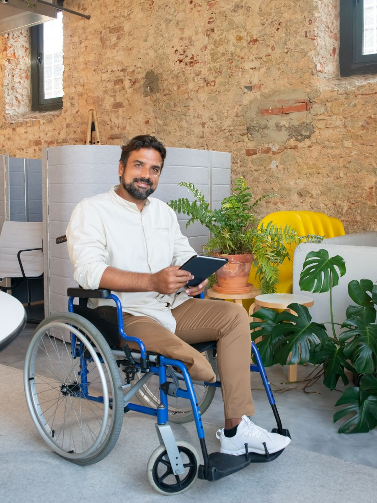
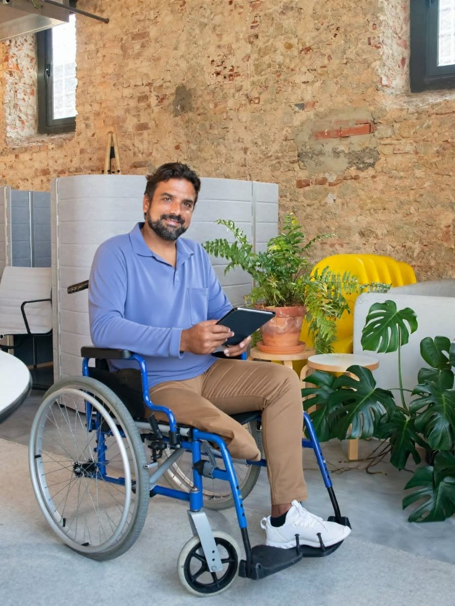

# AdClo

**Adaptive clothing that works the way you do.**

Tell AdClo what makes dressing hard (limited grip, one hand, a carer helping, sensory needs, a brace,
a medical device or sitting all day). It ranks real adaptive clothes from IZ Adaptive, Silverts and
BILLY Footwear for you, shows them on **your own photo** with YouCam virtual try-on, and an AI stylist
you can talk to builds whole outfits and talks back. Every Buy link opens that exact product.

**Live app:** https://adclo.vercel.app · **Demo video (3 min, two shoppers end to end):** [`demo/adclo-demo.mp4`](demo/adclo-demo.mp4)

| Your photo | Tried on with YouCam (IZ Adaptive open-back polo) |
|---|---|
|  |  |

About 1.3 billion people live with a significant disability (WHO): limited grip, using one hand,
needing help to dress, sensory sensitivity, a prosthetic or brace, a medical device, or sitting all day.
Most shopping filters only cover size and colour. AdClo starts from the problem
("buttons are hard for my hands", "I sit all day") and ranks garments by whether they solve it,
then uses **YouCam AI Clothes Virtual Try-On** to show the piece on the shopper's own photo.

## How it works

AdClo is a shopping app built around a **fit profile**: what makes dressing hard (sitting all day,
limited grip, one-handed dressing, assisted dressing, sensory needs, a prosthetic or brace, medical
access), who you shop for, your usual sizes and a photo of you.

- **Shop by category**: tops, bottoms, jackets, shoes and dresses. Every piece is ranked by how well
  it fits your needs, with plain reasons ("No back pockets to press into your skin") and warnings.
- **Product page**: sizes (your usual size is marked), why it works for you, **Try it on me**, and
  **Complete the look**, which suggests matching pieces from other categories with a reason
  ("Charcoal lets the sky blue stand out · both smart").
- **AI stylist**: type or *say* what you need ("my cousin's wedding is Saturday, I dress with one hand,
  nothing bright, about $200"). AdClo shows what it understood, then builds an outfit and explains each
  pick. Voice input helps people who find typing hard, and the stylist answers out loud in a natural voice.
- **Quick style**: pick an occasion and a budget, no AI needed.
- **Your look**: the pieces you picked, one per slot. Try them all on together, then buy each one.
- **Full-outfit try-on**: try-ons are chained. Bottoms first, then top, jacket and shoes, each step
  using the previous result as the photo. Your own shoes are kept unless you try on new ones.

### How the AI stylist stays trustworthy

1. **Understand** (Groq, `openai/gpt-oss-120b`): the request becomes a structured plan (occasion, budget,
   needs, colours, specific pieces). Unknown values are thrown away.
2. **Shortlist** (AdClo's own rules): only real catalog pieces that meet the person's needs, avoid
   their colours and fit the budget. A tight budget drops the jacket or shoes before the essentials.
3. **Choose and explain** (Groq): the AI picks from the shortlist and writes why. Picks outside the
   shortlist or over budget are replaced by the rules-based choice, so it cannot invent clothes.

The prompts require person-first language, and a filter replaces phrases like "wheelchair-bound"
in anything the AI writes. Voice input uses Groq's `whisper-large-v3-turbo`.

**The try-on never invents a body.** Generative try-on fills in two full legs when it draws trousers, so on a photo of an amputee it adds a leg that isn't there. For shoppers who tick the limb-difference need, AdClo skips trousers and dresses in the try-on and says why; tops, jackets and shoes still try on, and the fit ranking still covers every piece.

**The stylist talks back.** Alongside the written answer, the AI writes a short, casual spoken reply,
the way a friend would talk you through the outfit, not a read-out of the page. It's spoken with Groq's
`canopylabs/orpheus-v1-english` (six voices to pick from). It plays on its own when "Talk back to me"
is on, and there's a Listen / Stop button on every answer. Replies are split into sentences under 200
characters (the model's limit) and played back to back. The Groq org admin must accept the Orpheus
terms once in the Groq console before voice output works.

Core logic lives in `lib/`: `agent.js` (AI stylist), `groq.js` (AI client), `match.js` (needs to features), `stylist.js` (pairing and outfits),
`outfit.js` (chained try-ons) and `youcam.js` (API client).

## YouCam API used

| Step | Endpoint |
|---|---|
| Upload image | `POST /s2s/v2.0/file/...`, then `PUT` to the signed URL |
| Start try-on | `POST /s2s/v2.0/task/cloth-v4` with `garment_category` `upper_body`, `lower_body`, `outer`, `shoes` or `full_body`. Later steps pass the previous result as `src_file_url`. `change_shoes: false` keeps the person's own shoes. |
| Get result | `GET /s2s/v2.0/task/cloth-v4/{task_id}` |

Tested on seated and standing photos, including a person in a wheelchair: tops, trousers, shoes and a
two-piece chained outfit all work, with the face, hands and any mobility aid left unchanged.

## Run it

Needs Node 20 or later.

```bash
npm install
cp .env.example .env      # add YOUCAM_API_KEY and GROQ_API_KEY
npm start                 # http://localhost:3000
```

Without an API key the app runs in **demo mode**: everything works, but the "try-on" returns your own
photo, so you can build the UI without spending API units. Without a Groq key, the AI stylist is
hidden and quick style still works.

### Catalog

`data/catalog.json` lists real products from adaptive brands (IZ Adaptive, Silverts, BILLY Footwear).
Each **Buy** button opens that exact product on the brand's own store. Photos in `public/garments/` are
the brand's product shots of the garment alone (no model). Prices are shown in each store's currency
(IZ Adaptive: CAD, BILLY: USD), so outfit totals are approximate. Product photos belong to their brands
and are used here only to show and link to their products; see `CREDITS.md`.

To add a product, use a front-facing photo of the garment alone. Items without a photo still appear,
but their try-on button is disabled. The logic tests use a separate sample catalog in `test/fixtures/`.

## Tests

```bash
npm test
```

## Accessibility

The app works with a keyboard and a screen reader, uses large touch targets (48px or more), supports
dark mode and reduced motion, announces try-on progress through a live region, and explains errors in
plain language.

## License

MIT
